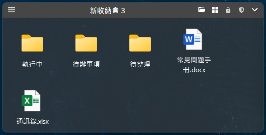
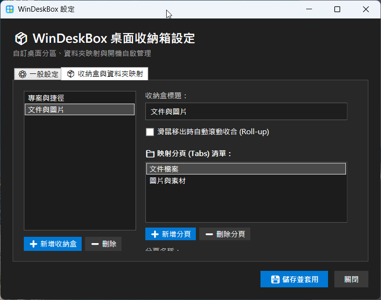

# 📦 WinDeskBox 桌面收納箱 v1.0.2 詳細使用說明書

> 專為 Windows 11 / 10 打造的輕量、高效、免安裝（Portable）現代桌面分區與資料夾映射收納工具。

---

## 📑 目錄

1. [軟體簡介與設計理念](#1-軟體簡介與設計理念)
2. [快速上手 (Quick Start)](#2-快速上手-quick-start)
3. [桌面收納盒 (Fence Box) 功能與操作指南](#3-桌面收納盒-fence-box-功能與操作指南)
   - [3.1 標題列 5 大快捷按鈕詳解](#31-標題列-5-大快捷按鈕詳解)
   - [3.2 視窗幾何操作（8 向縮放與智慧吸附）](#32-視窗幾何操作8-向縮放與智慧吸附)
   - [3.3 檔案互動與操作（雙擊啟動、拖曳存入、同名防呆）](#33-檔案互動與操作雙擊啟動拖曳存入同名防呆)
4. [自訂資料夾映射與多分頁系統 (Folder Portal & Tabs)](#4-自訂資料夾映射與多分頁系統-folder-portal--tabs)
   - [4.1 什麼是資料夾映射 (Folder Portal)？](#41-什麼是資料夾映射-folder-portal)
   - [4.2 多分頁 (Tabs) 管理與切換](#42-多分頁-tabs-管理與切換)
   - [4.3 推薦桌面配置實戰範例](#43-推薦桌面配置實戰範例)
5. [設定中心 (Settings Center) 詳細功能解說](#5-設定中心-settings-center-詳細功能解說)
   - [5.1 ⚙️ 一般設定](#51-️-一般設定)
   - [5.2 📦 收納盒與資料夾映射管理](#52--收納盒與資料夾映射管理)
   - [5.3 💾 儲存並套用（原地熱更新機制）](#53--儲存並套用原地熱更新機制)
6. [系統匣 (System Tray) 圖示功能](#6-系統匣-system-tray-圖示功能)
7. [企業資安與防毒相容性說明](#7-企業資安與防毒相容性說明)
8. [常見問題與疑難排解 (FAQ)](#8-常見問題與疑難排解-faq)

---

## 1. 軟體簡介與設計理念

在現代辦公與多工處理環境中，Windows 桌面經常堆滿了各類工作檔案、暫存截圖與應用程式捷徑。傳統的桌面整理軟體往往體積龐大、需要安裝、常駐背景耗電，甚至因底層跨進程行為而引發企業防毒軟體告警。

**WinDeskBox（桌面收納箱）** 是為此而生的現代化開源解決方案：
- **免安裝單一執行檔（Portable Single-File）**：無需安裝 .NET Runtime，下載單檔即開即用。
- **資料夾真實映射（Folder Portal）**：收納盒直連實體硬碟資料夾，檔案變更即時同步，不需手動複製搬移。
- **Windows 11 Fluent 現代美學**：原生 Acrylic 煙燻毛玻璃質感、JUMBO 256×256 高畫質無損圖示與極致銳利 ClearType 文字。
- **100% 企業防毒相容與離線安全**：純本地離線運行，完全不連網、不使用全域 Hook，經趨勢科技 Apex One 實機嚴格驗證零告警。

---

## 2. 快速上手 (Quick Start)

### 步驟 1：下載執行檔
前往 [GitHub Releases](https://github.com/baron0607/windows-desktop-organizer/releases/latest) 下載最新版本的 **`WinDeskBox-v1.0.2.exe`**。

### 步驟 2：放置與啟動
將 `WinDeskBox-v1.0.2.exe` 放置於您偏好的資料夾（例如 `D:\Tools\WinDeskBox\` 或隨身碟），直接**滑鼠雙擊**啟動。

### 步驟 3：開始使用
首次啟動時，WinDeskBox 會自動在桌面上建立兩個預設收納盒：
1. **「常用捷徑」**（映射至您的 Windows 桌面目錄）
2. **「執行中」**（映射至專案暫存目錄）

您可以使用預設快速鍵 **`Alt + D`** 隨時一鍵隱藏或顯示桌面所有收納盒。

---

## 3. 桌面收納盒 (Fence Box) 功能與操作指南

每一個收納盒均具備 Fluent 毛玻璃半透明面板與 26px 極簡精緻標題列。

<p align="center">
  
</p>

```text
┌──────────────────────────────────────────────────────────────────┐
│ [☰] 常用捷徑                     [📁] [⊞] [🔓] [🛡️] [⌄]          │
├──────────────────────────────────────────────────────────────────┤
│ [ 常用捷徑 ] [ 臨時暫存 ]                                         │
│ ┌──────────┐  ┌──────────┐  ┌──────────┐                         │
│ │  📄 文件  │  │  📊 報表  │  │  🚀 專案  │                         │
│ └──────────┘  └──────────┘  └──────────┘                         │
└──────────────────────────────────────────────────────────────────┘
```

### 3.1 標題列 5 大快捷按鈕詳解

| 按鈕圖示 | 功能名稱 | 操作說明 |
| :---: | :--- | :--- |
| **☰** | **漢堡選單 (Menu)** | 點擊展開收納盒選單：進入設定中心、重新命名分頁、切換排序依據等。 |
| **📁** | **開啟實體資料夾 (Open Folder)** | 一鍵在 Windows「檔案總管」中開啟當前分頁所映射的硬碟實體路徑。 |
| **⊞ / ☰** | **切換檢視模式 (View Mode)** | 在 **大圖示網格 (Grid)** 與 **詳細檔案清單 (List)** 之間一鍵切換。 |
| **🔒 / 🔓** | **位置與尺寸鎖定 (Lock)** | 切換鎖定狀態。鎖定後禁止滑鼠拖曳移動視窗與 8 向邊框縮放，防止誤觸跑位。 |
| **🛡️** | **隱私防護鎖定 (Privacy Shield)** | 一秒將收納盒內容毛玻璃模糊化並覆蓋綠色安全盾牌；在畫面上**滑鼠雙擊（點兩下）**即可立即解鎖。 |
| **⌄ / ⌃** | **手動收合 / 展開 (Roll-up)** | 點擊將收納盒摺疊為只有標題列的極窄狀態，再點一次展開還原。 |

---

### 3.2 視窗幾何操作（8 向縮放與智慧吸附）

1. **拖曳移動**：
   - 滑鼠按住收納盒標題列空白處即可自由在桌面上拖動。
   - 拖曳至螢幕上下左右邊界約 15 像素時，會自動觸發**智慧吸附（Edge Snapping）**，平整靠齊螢幕邊框。
   - 拖曳放開時系統會**自動即時存檔（Auto-Save）**，下次重開機或更動設定時位置絕對精確固定。
2. **8 向全方位邊框縮放**：
   - 將滑鼠游標移至收納盒的 **上、下、左、右邊框**（游標變為 `↔` 或 `↕`）或 **四個角落**（游標變為 `↖` 或 `↗`）。
   - 按住滑鼠左鍵即可隨意拖拉調整收納盒尺寸，最小尺寸限制為 180×100 px。

---

### 3.3 檔案互動與操作（雙擊啟動、複製/剪下/貼上、安全拖曳複製、同名防呆）

- **雙擊開啟檔案 / 程式**：直接雙擊收納盒內的任一圖示，即可透過系統預設程式開啟文件或直接啟動應用程式。
- **📑 複製 / ✂️ 剪下 / 📋 貼上 (Clipboard)**：
  - **右鍵選單**：在任一檔案/資料夾上按右鍵可選擇 **「📑 複製 (Ctrl+C)」** 或 **「✂️ 剪下 (Ctrl+X)」**；在收納盒空白處按右鍵可選擇 **「📋 貼上 (Ctrl+V)」**。
  - **鍵盤快捷鍵**：
    - `Ctrl + C`：複製選取的檔案/資料夾。
    - `Ctrl + X`：剪下選取的檔案/資料夾。
    - `Ctrl + V`：貼上剪貼簿內容至當前分頁。
    - `F2`：快速進入重新命名。
    - `F5`：手動重新整理清單。
    - `Delete`：安全移至 Windows 資源回收筒。
  - 與 Windows 檔案總管及桌面 100% 互通支援！
- **安全拖曳複製檔案 (Drag & Drop - Safe Copy Mode)**：
  - 從桌面、檔案總管或瀏覽器下載列，將任意檔案/資料夾拖入收納盒中。
  - 系統全面採用 **安全複製（Copy）** 模式：**來源端原始檔案完好無損保留在原處**，收納盒映射目錄中則產生完整副本。
- **同名檔案自動防呆**：
  - 若存入或貼上的檔案在目標資料夾中已存在同名檔案，WinDeskBox 會彈出防呆對話框，支援「保留兩者（自動編號為 `檔名 (1).ext`）」、「覆蓋」或「略過」，絕不無故覆蓋您的寶貴資料。

---

## 4. 自訂資料夾映射與多分頁系統 (Folder Portal & Tabs)

### 4.1 什麼是資料夾映射 (Folder Portal)？
傳統收納工具需要將捷徑手動丟進軟體專屬資料庫；而 WinDeskBox 採用 **Folder Portal 實體映射機制**：
- 收納盒顯示的即為您硬碟資料夾的**真實內容**。
- 您在收納盒或檔案總管中新增、刪除、修改檔案，兩端均會透過非同步檔案監聽即時同步反映。

### 4.2 多分頁 (Tabs) 管理與切換
每個收納盒頂部可容納多個分頁（Tabs）：
- **切換分頁**：直接點擊分頁標籤名稱即可切換。
- **分頁獨立配置**：每個分頁可各自指定不同的本機資料夾路徑、檢視模式（大圖示/清單）與排序規則（依修改時間、名稱、副檔名）。

### 4.3 推薦桌面配置實戰範例

| 收納盒名稱 | 推薦分頁 1 | 推薦分頁 2 | 推薦映射路徑 | 用途特色 |
| :--- | :--- | :--- | :--- | :--- |
| **🚀 快速啟動盒** | 常用工具 | 辦公軟體 | `D:\Shortcuts\Tools` | 集中放置常用軟體捷徑，大圖示排列 |
| **📂 專案進行中** | 本週待辦 | 參考資料 | `D:\Projects\Active` | 當前執行中專案，清單檢視，依時間遞減排序 |
| **📥 暫存與下載** | 桌面暫存 | 待整理區 | `D:\Downloads\Temp` | 存放截圖、暫存 PDF，啟用「移出自動收合」 |

---

## 5. 設定中心 (Settings Center) 詳細功能解說

### 進入設定中心的途徑：
1. 右鍵點擊右下角系統匣圖示 ➜ 選擇 **「⚙️ 設定...」**。
2. 點擊任一收納盒左側 **☰ 漢堡選單** ➜ 選擇 **「⚙️ 收納盒與資料夾映射設定...」**。

<p align="center">
  
</p>

---

### 5.1 ⚙️ 一般設定

```text
┌─────────────────────────────────────────────────────────────┐
│ ☑ 隨 Windows 開機自動啟動 (Launch on Startup)                │
│ ☐ 全域鎖定所有收納盒位置 (禁止拖曳與縮放)                      │
│                                                             │
│ ┌─ ⌨️ 全域切換收納盒 隱藏 / 顯示 快速鍵 ────────────────────┐ │
│ │ 組合修飾鍵：☑ Alt  ☐ Ctrl  ☐ Shift  ☐ Win ＋ 主按鍵：[ D ▼]│ │
│ └───────────────────────────────────────────────────────────┘ │
│                                                             │
│ 🧹 桌面一鍵整理工具                                         │
│ [ 立即整理桌面散亂檔案 ]   [ 一鍵還原檔案至桌面 ]             │
└─────────────────────────────────────────────────────────────┘
```

1. **隨 Windows 開機自動啟動 (Launch on Startup)**：
   - 勾選後將寫入使用者註冊表啟動項，開機進入桌面時自動於背景啟動 WinDeskBox。
2. **全域鎖定所有收納盒位置**：
   - 一鍵鎖定桌面所有收納盒，防止日常操作誤觸拖動。
3. **⌨️ 全域切換快速鍵自訂**：
   - 可自由勾選修飾鍵（`Alt` / `Ctrl` / `Shift` / `Win`）並從下拉選單選取主按鍵（A~Z、0~9、F1~F12、Space、Tab 等）。
   - 儲存後立即動態生效，並同步更新系統匣右鍵選單的快速鍵提示字樣。
4. **🧹 桌面一鍵整理工具**：
   - **立即整理桌面散亂檔案**：自動掃描 Windows 桌面上散亂的檔案，依據副檔名（文件、圖片、壓縮檔等）自動歸類至桌面 `_桌面收納箱` 資料夾中。
   - **一鍵還原檔案至桌面**：若整理後想復原，點擊此按鈕即可將已歸檔的檔案安全搬移回桌面。

---

### 5.2 📦 收納盒與資料夾映射管理

- **左側清單**：
  - 列出目前所有桌面收納盒。
  - 點擊 **「➕ 新增收納盒」** 可建立新的收納分區。
  - 點擊 **「➖ 刪除」** 可移除選定的收納盒（僅移除收納盒介面，**硬碟實體檔案 100% 安全保留**）。
- **右側詳細設定卡片**：
  - **收納盒標題**：輸入新名稱時，左側清單會**即時同步打字內容**。
  - **滑鼠移出自動收合 (Roll-up)**：勾選後，滑鼠離開收納盒時自動捲收為極簡標題列，滑鼠移入時自動展開。
  - **分頁 (Tabs) 列表管理**：可為該收納盒新增或刪除分頁。
  - **分頁顯示名稱與路徑**：輸入自訂分頁名稱，並點擊 **「📁 瀏覽選取...」** 選取本機硬碟資料夾。

---

### 5.3 💾 儲存並套用（原地熱更新機制）

- 點擊設定視窗右下角 **「💾 儲存並套用」**：
  - 系統採用 **In-Place Hot Update 原地熱更新技術**，立即在背景無縫更新桌面收納盒的標題、分頁、路徑與快速鍵。
  - **設定視窗不會被強制關閉**，且**收納盒絕不會跳到最前台遮擋您的畫面**。
- 確認設定完成後，點擊 **「關閉」** 即可優雅退出設定面板。

---

## 6. 系統匣 (System Tray) 圖示功能

WinDeskBox 啟動後會在 Windows 右下角工作列系統匣常駐專屬圖示：

- **滑鼠左鍵單擊**：一秒切換所有收納盒之「顯示 / 隱藏」。
- **滑鼠右鍵點擊選單**：
  - 👁️ **隱藏收納盒 / 顯示收納盒**（附帶當前快速鍵提示，如 `Alt + D`）
  - ➕ **新增收納盒**（直接在桌面新增一個新方盒）
  - 🔒 **鎖定 / 解鎖所有收納盒**
  - ⚙️ **隨開機自動啟動**（可直接打勾切換）
  - 🛠️ **設定...**（開啟完整設定中心）
  - 🚪 **結束 WinDeskBox**（完全退出程式）

---

## 7. 企業資安與防毒相容性說明

WinDeskBox 專為高資安要求的企業與個人環境設計，遵循以下嚴格標準：

1. **100% 離線運行**：程式無任何網路連線模組，不包含任何資料收集或遙測回傳（Telemetry）程式碼。
2. **免安裝綠色單檔 (Portable)**：不向系統目錄注入 DLL、不修改系統關鍵底層元件。
3. **無全域 Hook 與注入風險**：採用 Windows 官方標準 `RegisterHotKey` 與標準桌面層級綁定，完全排除跨進程鍵盤/滑鼠 Hook，實機相容於趨勢科技（Trend Micro Apex One）、Windows Defender 等 EDR 企業防毒軟體，零封鎖、零誤判。

---

## 8. 常見問題與疑難排解 (FAQ)

### Q1：重新開機後，收納盒的位置或分頁設定會消失嗎？
不會。WinDeskBox 在每次拖曳移動、8 向縮放放開或點選「儲存並套用」時，均會自動將最新座標與設定持久化儲存於同目錄下的 `config.json` 中。開機自啟後會精準還原至原本位置。

### Q2：如何暫時把所有收納盒隱藏起來？
按下您設定的全域快速鍵（預設為 **`Alt + D`**），或點擊右下角系統匣圖示，即可一秒將桌面所有收納盒隱藏；再按一次即可立即恢復顯示。

### Q3：不小心把收納盒拖到螢幕外面看不到怎麼辦？
WinDeskBox 內建 `ScreenBoundsGuard` 智慧邊界守衛。當切換螢幕解析度或多螢幕拔除時，系統會自動偵測並將超出螢幕範圍的收納盒平滑拉回可視工作區內。

### Q4：刪除收納盒或分頁會把我的檔案刪除嗎？
**絕對不會**。WinDeskBox 是資料夾的「視窗映射（Portal）」，刪除收納盒或分頁僅僅是關閉該展示視窗，您硬碟中的實體資料夾與檔案完全不會受到任何影響。

### Q5：如何徹底移除 WinDeskBox？
1. 在設定視窗中取消勾選「隨 Windows 開機自動啟動」。
2. 右鍵點擊系統匣圖示選擇「結束 WinDeskBox」。
3. 直接刪除 `WinDeskBox-v1.0.2.exe` 與產生的 `config.json` 即可，系統乾淨無殘留。

---

<div align="center">

**WinDeskBox 桌面收納箱**  
[GitHub 專案首頁](https://github.com/baron0607/windows-desktop-organizer) ｜ [最新版本下載](https://github.com/baron0607/windows-desktop-organizer/releases/latest)

</div>